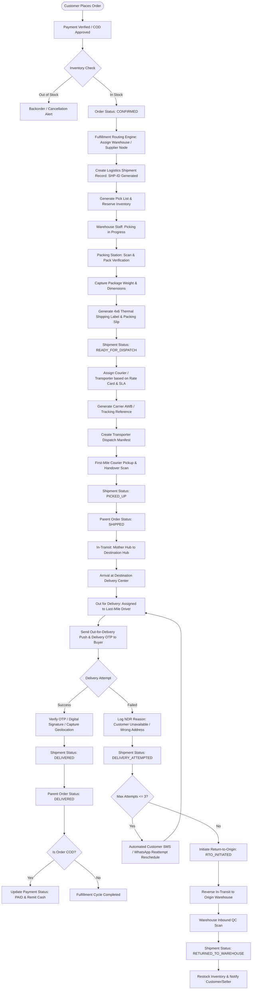
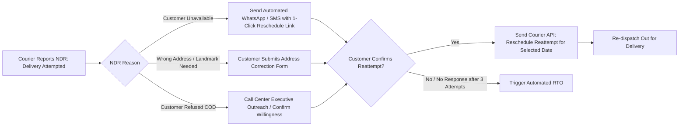

# Business Workflows & State Machine Specifications
**Document:** `docs/logistics/BUSINESS_WORKFLOW.md`  
**Purpose:** End-to-End Operational Lifecycle Diagrams, Transitions & Exception Paths  
**Status:** Architecture Blueprint  

---

## 1. End-to-End Order-to-Delivery Master Workflow

The lifecycle bridges the existing e-commerce checkout with warehouse fulfillment, transporter logistics, and final delivery:

---

## 2. Comprehensive Status State Machine & Guardrails

To prevent data corruption, status transitions must obey a strict directed graph:

| Current Status | Allowed Next Statuses | Trigger Event | Trigger Actor |
| :--- | :--- | :--- | :--- |
| `ORDER_CONFIRMED` | `AWAITING_FULFILLMENT`, `CANCELLED` | Order paid or COD confirmed | E-commerce Core / System |
| `AWAITING_FULFILLMENT` | `READY_TO_PICK`, `CANCELLED` | Warehouse allocated | Logistics Engine |
| `READY_TO_PICK` | `PICKING_IN_PROGRESS`, `CANCELLED` | Pick list printed / started | Warehouse Operator |
| `PICKING_IN_PROGRESS` | `PACKING_COMPLETED`, `READY_TO_PICK` (Re-queue) | Items picked from bins | Warehouse Operator |
| `PACKING_COMPLETED` | `READY_FOR_DISPATCH`, `CANCELLED` | Box verified and packed | Packing Station |
| `READY_FOR_DISPATCH` | `PICKUP_SCHEDULED`, `PICKED_UP`, `CANCELLED` | Manifest generated | Dispatch Executive |
| `PICKUP_SCHEDULED` | `PICKED_UP`, `READY_FOR_DISPATCH` (Reschedule) | Transporter pickup scan | Courier Partner / Driver |
| `PICKED_UP` | `IN_TRANSIT`, `CANCELLED` (Pre-haul) | Transporter origin hub scan | Courier Partner / System |
| `IN_TRANSIT` | `REACHED_DESTINATION_HUB`, `DELAYED` | Hub in-scan milestone | Courier Partner Webhook / Tracking |
| `REACHED_DESTINATION_HUB` | `OUT_FOR_DELIVERY`, `DELAYED` | Loaded to delivery van | Delivery Center Supervisor |
| `OUT_FOR_DELIVERY` | `DELIVERED`, `DELIVERY_ATTEMPTED`, `DELIVERY_FAILED` | Delivery driver action | Field Rider / Courier Agent |
| `DELIVERY_ATTEMPTED` | `OUT_FOR_DELIVERY` (Reattempt), `RTO_INITIATED` | Reattempt scheduled or max attempts breached | NDR Executive / Automated Bot |
| `DELIVERY_FAILED` | `OUT_FOR_DELIVERY`, `RTO_INITIATED` | Final resolution | Logistics Manager |
| `RTO_INITIATED` | `RTO_IN_TRANSIT` | Return line-haul created | Courier Partner |
| `RTO_IN_TRANSIT` | `RETURNED_TO_WAREHOUSE` | Origin warehouse receiving scan | Warehouse Inbound Dock |
| `DELIVERED` | `RETURN_REQUESTED` | Customer return claim | Customer App |
| `RETURNED_TO_WAREHOUSE` | *Terminal State* | QC verified & restocked | Warehouse QC Manager |
| `CANCELLED` | *Terminal State* | Order cancelled | Admin / Customer |

---

## 3. Secondary Operational Workflows

### 3.1 Order Cancellation While in Logistics Pipeline
1. **Pre-Dispatch Cancellation (`READY_FOR_PICKUP` or earlier)**:
   - Cancellation flag is set.
   - Warehouse stock reservation is instantaneously released.
   - Shipment is marked `CANCELLED`.
   - The parcel is flagged at the packing/dispatch station as "DO NOT DISPATCH - RETURN TO BIN".
2. **Post-Dispatch Cancellation (`PICKED_UP` or `IN_TRANSIT`)**:
   - Transporter API is sent a "Return Consignment In-Transit" request (RTO).
   - Courier updates route to redirect the parcel back to origin.
   - Status updates directly to `RTO_INITIATED`.

### 3.2 Partial Shipment & Multi-Package Workflow
1. When an order contains items located across multiple warehouses or seller locations:
   - The Order-to-Shipment engine splits the order items into separate shipments (`Shipment 1`, `Shipment 2`).
   - Each shipment obtains its own unique Shipment ID and independent AWB tracking number.
   - The parent `Order` status reflects `PARTIALLY_SHIPPED` until all shipments are in transit, at which point it reflects `SHIPPED`.
   - Customer tracking displays itemized parcels under a unified parent order view.

### 3.3 Customer Return & Reverse Logistics Workflow
1. Customer initiates return request in `CustomerOrders` -> `ReturnRequest` table record created.
2. Admin reviews claim in `AdminReturnsManagement.jsx`.
3. Upon approval:
   - Reverse logistics engine schedules a return pickup at customer's address.
   - Reverse AWB is generated and assigned to a return courier partner.
   - Courier agent / field rider arrives, performs doorstep quality inspection using `driver_reverse_pickup.jsx` (checks barcode, brand tag, unused condition).
   - Upon pickup confirmation, status updates to `RETURN_PICKED_UP`.
   - In-transit reverse shipment tracking monitors return to origin depot.
   - Origin warehouse receives parcel, performs final QC scan.
   - System triggers customer wallet refund via `adminReturns.controller.js:updateReturnStatus`.

### 3.4 Non-Delivery Report (NDR) Management Workflow

