# Entity Relationship Diagram (ERD) & Relational Mapping
**Document:** `docs/logistics/ER_DIAGRAM.md`  
**Purpose:** Visual and relational mapping between existing E-Commerce entities and new Logistics tables  
**Status:** Architecture Blueprint  

---

## 1. Visual Entity Relationship Diagram

```mermaid
erDiagram
    %% Existing E-Commerce Core Entities
    PROFILES ||--o{ ORDERS : places
    PROFILES ||--o{ ADDRESSES : owns
    PROFILES ||--o{ NOTIFICATIONS : receives
    PROFILES ||--o{ LOGISTICS_SHIPMENTS : delivers_as_driver
    ORDERS ||--|{ ORDER_ITEMS : contains
    PRODUCTS ||--|{ ORDER_ITEMS : ordered_as
    ORDERS ||--o{ RETURN_REQUESTS : claims
    ORDERS ||--o| WALLET_TRANSACTIONS : settles

    %% Integration: Orders & Products to Logistics
    ORDERS ||--o{ LOGISTICS_SHIPMENTS : fulfilled_by
    LOGISTICS_WAREHOUSES ||--o{ LOGISTICS_SHIPMENTS : originates_from
    LOGISTICS_PARTNERS ||--o{ LOGISTICS_SHIPMENTS : transports
    LOGISTICS_WAREHOUSES ||--o{ LOGISTICS_WAREHOUSE_STOCK : stores
    PRODUCTS ||--o{ LOGISTICS_WAREHOUSE_STOCK : inventoried_at

    %% Shipment Granular Decomposition
    LOGISTICS_SHIPMENTS ||--|{ SHIPMENT_PACKAGES : contains
    LOGISTICS_SHIPMENTS ||--|{ SHIPMENT_ITEMS : comprises
    ORDER_ITEMS ||--o| SHIPMENT_ITEMS : mapped_to
    LOGISTICS_SHIPMENTS ||--|{ SHIPMENT_TRACKING_EVENTS : generates
    LOGISTICS_SHIPMENTS ||--o{ DELIVERY_ATTEMPTS : logs_ndr
    LOGISTICS_SHIPMENTS ||--o| PROOF_OF_DELIVERY : confirms_with
    LOGISTICS_SHIPMENTS ||--o{ LOGISTICS_EXPENSES : incurs
    LOGISTICS_SHIPMENTS ||--o{ LOGISTICS_DOCUMENTS : generates_docs

    %% Partner & Warehouse Operations
    LOGISTICS_PARTNERS ||--|{ LOGISTICS_RATE_CARDS : configures
    LOGISTICS_PARTNERS ||--o{ LOGISTICS_SERVICEABLE_PINCODES : services
    LOGISTICS_WAREHOUSES ||--o{ PICKUP_REQUESTS : schedules
    LOGISTICS_PARTNERS ||--o{ PICKUP_REQUESTS : services_pickup
    LOGISTICS_WAREHOUSES ||--o{ DISPATCH_MANIFESTS : manifests
    LOGISTICS_PARTNERS ||--o{ DISPATCH_MANIFESTS : receives_manifest
    LOGISTICS_WAREHOUSES ||--o{ LOGISTICS_FLEET_VEHICLES : owns_vehicles

    PROFILES {
        string id PK "Firebase UID"
        string email
        string fullName
        enum role "CUSTOMER, SUPPLIER, DRIVER, ADMIN"
    }

    ORDERS {
        uuid id PK
        string userId FK
        float totalAmount
        enum orderStatus "ORDERED, CONFIRMED, SHIPPED, DELIVERED"
        enum paymentMethod "COD, UPI, CARD, WALLET"
        enum paymentStatus "PENDING, PAID, REFUNDED"
        json shippingAddress "Address snapshot & legacy courier tracking"
    }

    PRODUCTS {
        uuid id PK
        string title
        float price
        int stock "Platform Master Stock"
        string sku
        string supplierId
    }

    LOGISTICS_SHIPMENTS {
        uuid id PK
        string shipment_number UK "Unique SHP-YYYYMMDD-XXXXXX"
        uuid order_id FK
        uuid warehouse_id FK
        uuid partner_id FK
        string awb_number UK
        string status "READY_FOR_DISPATCH, IN_TRANSIT, DELIVERED"
        decimal dead_weight_kg
        decimal volumetric_weight_kg
        decimal billable_weight_kg
        decimal cod_amount
    }

    LOGISTICS_WAREHOUSES {
        uuid id PK
        string warehouse_code UK
        string name
        string pincode
        string type "CENTRAL_HUB, REGIONAL, SUPPLIER"
    }

    LOGISTICS_PARTNERS {
        uuid id PK
        string partner_code UK "DELHIVERY, BLUEDART, SHADOWFAX"
        string name
        string tracking_url_template
        string status "ACTIVE, INACTIVE"
    }

    SHIPMENT_TRACKING_EVENTS {
        uuid id PK
        uuid shipment_id FK
        string status
        string location
        string description
        string source "COURIER_WEBHOOK, DRIVER_APP, ADMIN"
        timestamp event_time
    }

    PROOF_OF_DELIVERY {
        uuid id PK
        uuid shipment_id FK
        string receiver_name
        boolean otp_verified
        string signature_image_url
        string delivery_photo_url
        timestamp delivered_at
    }
```

---

## 2. Foreign Key & Data Integrity Rules

1. **Cascade Deletions Prevented on Core Orders**:
   - `logistics_shipments.order_id` uses `onDelete: Restrict` or `SetNull` to guarantee historical shipping records remain intact even if an order record is archived.
2. **Atomic Inventory Reservation**:
   - When a shipment is created, `logistics_warehouse_stock.reserved_stock` is incremented. Upon physical dispatch (`PICKED_UP`), `Product.stock` and `available_stock` are decremented and reservation is cleared.
3. **Immutable Tracking Auditing**:
   - `shipment_tracking_events` records are append-only. No `UPDATE` or `DELETE` queries are permitted.
